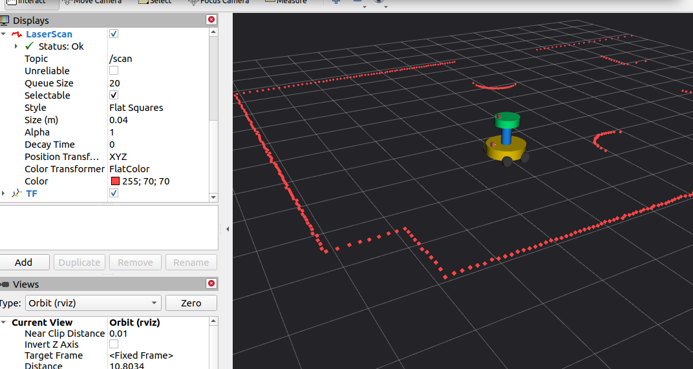

# thl roscar

ROS1 Noetic 四轮四驱机器人建模、Gazebo 仿真与激光可视化项目。最新阶段：2026-10-17。

从两驱动轮＋两个小支撑轮改成四个独立驱动轮，保留双层圆柱车体。已完成四驱插件、前进与双向转向、摩擦模型A/B、实测关节状态、TF、激光雷达与Gazebo/RViz显示。历史两轮版RGB-D和点云资料仍保留，但尚未恢复进当前四轮配置。

[接手入口](START_HERE.md) · [当前状态](context/CURRENT_STATE.md) · [今日实践报告](docs/PRACTICE_LOG_2026-10-17.md) · [运行手册](docs/RUNBOOK.md) · [五张截图与原记录](evidence/2026-10-17_4wd/README.md) · [公开提交材料](submissions/2026-10-17-public/README.md)

## 当前实际效果



用户提供的真实截图。红点是/scan观测，不是SLAM栅格地图；静态截图不单独证明运动位移，运动结论有终端记录支持。


## 当前成果与边界

| 模块 | 实际结果 | 证据与限制 |
| --- | --- | --- |
| 四轮实体 | 10 Link、9 Joint、6活动关节 | 移除旧小支撑轮；模型服务与Xacro检查 |
| 四电机控制 | 独立C++插件，100Hz配置，5Nm/轮 | 实际.so加载及前进、左转、右转／停止记录 |
| 摩擦A/B | 单次左转净平移约7.37cm→1.23cm | 仅改pyramid/cone；不能当作多次统计结论 |
| 关节与TF | Gazebo实测六关节，单个RSP | H/I两次完整约40秒窗口无观测到时间戳异常 |
| 激光与RViz | 约5.495Hz，360有效样本 | 视场6rad约343.8度，不是完整360度 |
| 房间与障碍物 | 8个World模型＋单独spawn机器人 | 课程几何复用，4墙碰撞及哈希复核 |
| 四轮RGB-D／点云 | 尚未恢复 | 两轮历史成果不能直接继承为当前能力 |
| SLAM／AMCL／导航 | 未实施或未验收 | 不声称自主避障、地图或导航完成 |

cone场景前进单次约0.240039m；左右转约±26度，净平移约1.23cm，零指令后检查到停止样本。转向时车体角速度约±0.1513rad/s，低于±0.20指令；轮速正确不等于精确轨迹跟踪。里程计是Gazebo世界真值，不是编码器定位精度验证。

## 运行环境与当前入口

Ubuntu20.04.6 LTS、ROS1 Noetic、Gazebo Classic11.15.1、RViz1.14.26；实际运行在用户VMware。助手Windows源码副本不等于VM现场。

已准备好的原工作空间中，在旧仿真确已退出、端口空闲后，终端A：

```bash
source /home/thl/catkin_ws/devel/setup.bash
roslaunch rcdp myrobot_4wd_laser_step11i.launch friction_model:=cone_model
```

终端B：

```bash
source /home/thl/catkin_ws/devel/setup.bash
LIBGL_ALWAYS_SOFTWARE=true rosrun rviz rviz -d /home/thl/catkin_ws/src/rcdp/config/lesson14_scan_step8.rviz __name:=lesson14_4wd_rviz
```

原Launch不自动开RViz。不要叠加旧两轮Launch、点云中继或第二个控制器。每次先检查现场，不根据旧PID认为进程仍在线。需要从源码重建时先读[运行手册](docs/RUNBOOK.md)。

## 项目目录

| 目录 | 内容 |
| --- | --- |
| catkin_ws/src/rcdp | 原阶段＋新增step11A–I模型、Launch、场景、TF、雷达、运动和检查脚本 |
| catkin_ws/src/rcdp_4wd_stampfix | 当前四电机插件源码、上游BSD来源和12项源码测试 |
| catkin_ws/src/rcdp_stampfix | 历史两轮时间戳修复源码，保留作参考而非当前入口 |
| submissions/2026-10-17-public | 15页DOCX/PDF、独立源码、5张PNG、日志和复现README；姓名／班级／学号已移除 |
| archives/2026-10-17_4wd | 今日10份原始增量ZIP，以及公开脱敏提交包 |
| evidence/2026-10-17_4wd | 5张原始截图、7份用户终端附件、解析JSON和来源说明 |
| courseware、study、reference | 既有Lesson1–15 PDF、学习索引、Lesson13–15原始代码ZIP；不重复上传相同文件 |
| context、docs | 当前接手信息、操作复盘、架构、运行及历史记录 |
| metadata、tests、tools | 清单、校验值、单元测试、归档检查工具 |

历史课程资料与范围见[资源导航](docs/RESOURCES.md)，历史两轮问题见[step10修复](docs/TIMESTAMP_FIX_STEP10.md)。

## 离线检查

```bash
python3 -m unittest discover -s tests -v
python3 catkin_ws/src/rcdp_4wd_stampfix/test/test_source_step11b.py
python3 tools/verify_archive.py
```

这是源码／数学／XML／ZIP及文件一致性检查，不是Windows上的Gazebo原生运行。原VM结果依据用户日志和截图；整理后的独立提交工作空间入口仅离线等价检查，尚未在干净Ubuntu完整编译运行。不上传build、devel、.so或VM磁盘。

## 安全与公开范围

只有课程仿真在范围内。非零运动前确认/cmd_vel无竞争发布者、仿真未暂停、周围空旷；使用有限测试并显式发零。插件尚无完善命令超时看门狗，关闭发布者不保证停车。勿将测试直接用于实车。

本次按用户选择上传公开脱敏版，移除新报告和提交材料中的姓名、班级、学号；原件留在本地。不是全仓历史清理，历史文件可能仍含个人资料，VM用户名／路径及上游署名不伪称全部匿名。保留课程资料与BSD上游权利，不添加覆盖全仓的开源授权。详见[权利与隐私](RIGHTS_AND_PRIVACY.md)。录屏按用户要求未处理，未伪造MP4。
