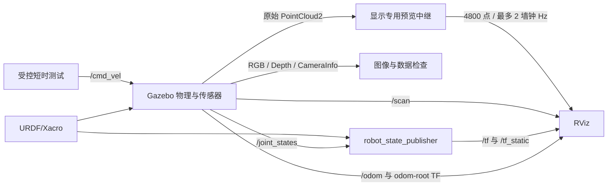

# 系统架构

## 目标与边界

本项目实现课程差速车在 ROS1 Noetic / Gazebo Classic 中的模型、运动、传感器与显示链路，关注逐阶段可验证、故障可追溯。不是实车驱动平台，不声称已完成自主导航。

## 数据链路



ROS master 负责发现与注册，不把它画成所有传感器数据必须经过的中转服务器。preview 不发布 TF、速度、服务或参数写入。

## 分层文件组织

| 层 | 入口／职责 | 注意事项 |
| --- | --- | --- |
| 物理模型 step4 | myrobot_gazebo_step4.xacro | collision、inertial、双层几何；质量为教学仿真假设 |
| 驱动 step6 | myrobot_drive_step6.xacro | 只加一个直接 diff_drive，不叠加 Arbotix/ros_control |
| 雷达 step7 | myrobot_laser_step7.xacro | 保留模型／驱动，追加 scan 传感器 |
| 关节／TF step8 | myrobot_tf_step8.xacro | 其他四关节来自 Gazebo；两驱动轮来自已有驱动 |
| RGB-D step9 | myrobot_camera_step9.xacro | 光学 link 和传感器；物理主体与已有控制不变 |
| 显示 step9a | cloud_preview_step9a.py | 行列抽样、墙钟节流、原始数据不改 |

每个组合 Xacro 包含上一层；新增功能不需要复制整份模型。只启动最新需要的 launch，不是把每层 launch 都开一次。

## TF 与关节状态责任

```text
odom
└── root_link                     Gazebo diff_drive
    └── base_link                 robot_state_publisher
        ├── left/right wheels     RSP 使用驱动轮位置
        ├── support wheels        RSP 使用辅助 Gazebo joint states
        ├── depth_camera_link     RSP 使用辅助关节位置
        │   └── rotate_depth_camera_link   RSP 固定光学变换
        └── support_link
            └── platform_link
                └── laser_scan_link       RSP 使用辅助关节位置
```

树中 wheels/support wheels 是概念性分组，不是实际 link 字面名称。实际名称以源码为准。完整模型 11 links / 10 joints，6 个活动关节；不把模型树的静态覆盖冒充实时全关节消息清单。

`odom → root_link` 与内部关节 TF 必须各有明确责任。`/tf` 上出现两个发布节点本身可以正常，不能只数节点就断定冲突。当前重复时间戳警告尚未定位，不通过禁用 odom 或增添重复静态变换掩盖它。

## 主要接口

| 接口 | 消息类型／用途 | frame／限制 |
| --- | --- | --- |
| /cmd_vel | geometry_msgs/Twist，差速速度请求 | 非零发布停止不自动保证车停 |
| /odom | nav_msgs/Odometry | world 真值源，不是实物编码器验证 |
| /scan | sensor_msgs/LaserScan | laser_scan_link；360 样本但扫描角约 343.8° |
| /joint_states | sensor_msgs/JointState | 两组插件发布互不重叠的关节集合 |
| /kinect/rgb/image_raw | sensor_msgs/Image | rotate_depth_camera_link |
| /kinect/depth/image_raw | sensor_msgs/Image，32FC1 | 米，光学 Z；无效深度不能当普通数值 |
| /kinect/*/camera_info | sensor_msgs/CameraInfo | 原始 640×480 内参，不是抽稀后点阵的内参 |
| /kinect/depth/points | sensor_msgs/PointCloud2 | 640×480 原始点云，XYZ+RGB |
| /lesson14/depth_points_preview | sensor_msgs/PointCloud2 | 80×60，仅供显示；保留 stamp/frame/所选点完整记录 |

## 显示恢复策略

原始完整点云曾触发 RViz SIGBUS。可用方案是每次 RViz 命令使用 `LIBGL_ALWAYS_SOFTWARE=true`，再将原始点云经独立中继抽稀，单队列、最多 2 墙钟 Hz、无显示订阅者时解绑原始输入。

这改变了渲染和输出负载等多个条件，不能反推某个唯一根因。原始相机活跃生成负担没有被中继直接降低；完整原始显示与 TF 警告仍需后续证据定位。

## 后续扩展

未来从当前 scan、odom、TF 接 rs_nav：先依赖与键盘，后 Gmapping／保存地图，再停建图切 AMCL，最后 move_base。导航参数须从老师的 laser_camera 改为当前 laser_scan_link；地图路径及场景也要一致。仅是路线，不标注为已实现。
