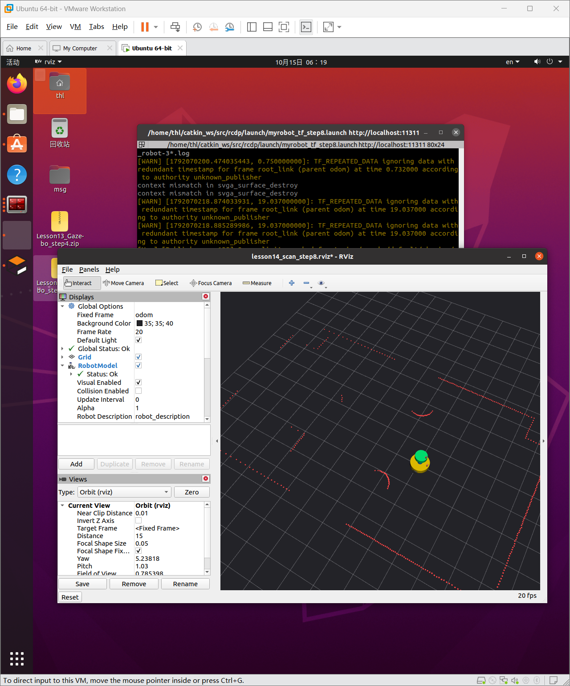
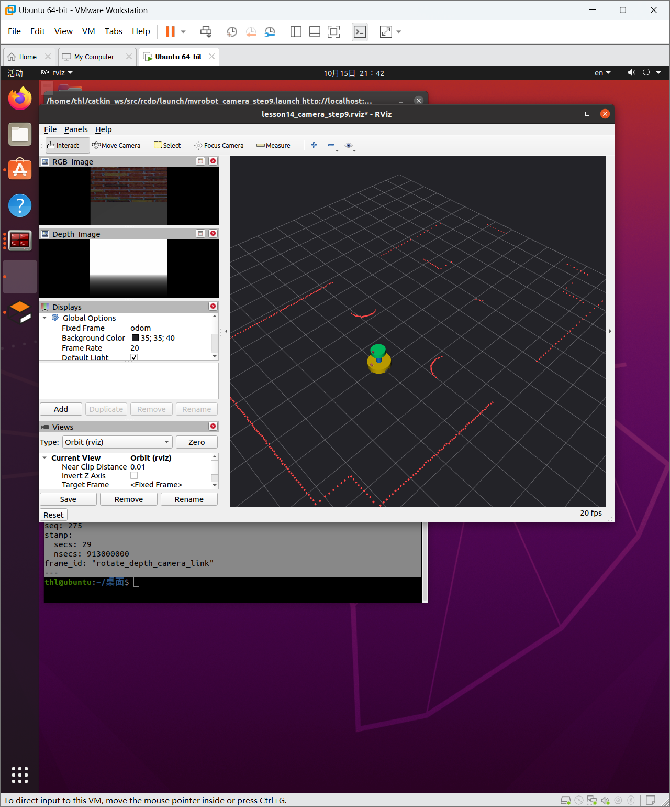

# 用户现场截图

图片是用户提供的原图，没有用生成图、改画面或合成示例替代真实结果。文件名日期沿用用户原文件；截图中的 VM 时钟与 Windows 日期可能不同，不据此改写运行顺序。

| 阶段 | 文件 | 观察与边界 |
| --- | --- | --- |
| step4/6 基础模型 | [Gazebo 模型旧图](../gazebo_model_user_screenshot_2026-10-14.png) | 双层圆柱、驱动／支撑轮外形；不是单凭截图证明运动或传感器 |
| step8 TF/RViz | [模型与雷达](step8_rviz_laser_2026-10-15.png) | Fixed Frame=odom；模型、红色墙面扫描，RobotModel/Global 状态 OK；后台仍有黄色 TF 警告 |
| step9 RGB-D | [RGB/深度图与扫描](step9_rgb_depth_2026-10-16.png) | 两个图像窗口、车体和扫描；不是完整大点云稳定性证明 |

## 模型与激光

## RGB-D

最新轻量点云暂无用户新截图，验收依据是终端数据和明确稳定性反馈。不要把上面图片标为 step9a 点云截图。截图内可见课程 VM 的用户名／路径，按本次用户请求保存；不代表可将其中历史 PID／路径不加核对地直接复用。
