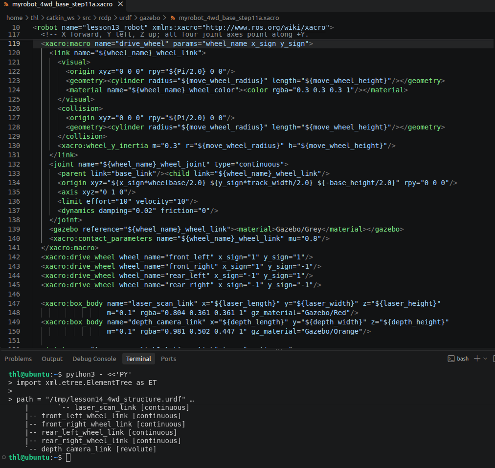
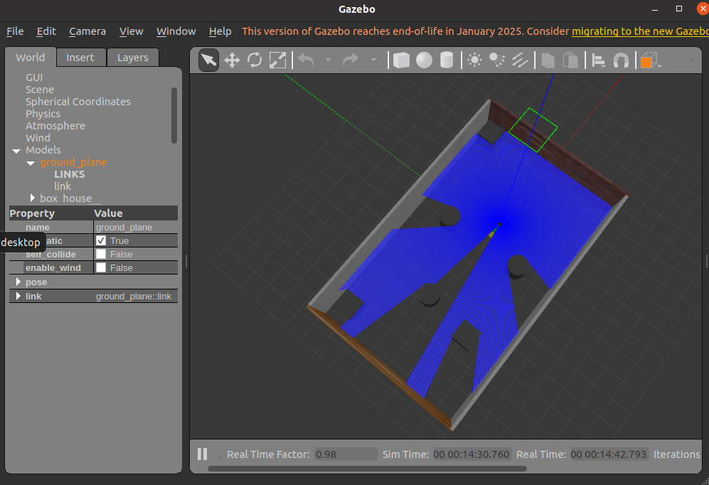
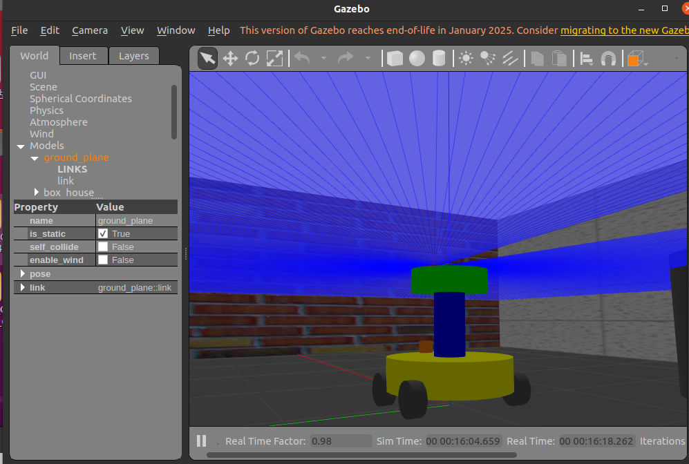
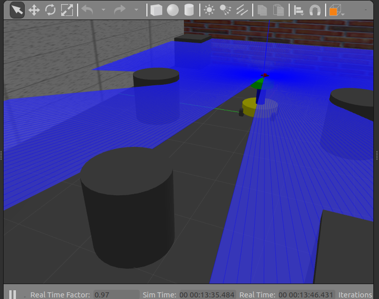

# 机器人建模及仿真场景搭建报告

实践日期：2026年10月17日
项目：ROS 四轮四驱差速机器人建模与 Gazebo 仿真

## 第一章 实践目的与主要任务

### 1.1 实践目标与开发环境

本次实践在已有双层圆柱机器人基础上，将原来的两个驱动轮和两个小支撑轮改为四个普通驱动轮，采用左右差速实现前进与转向。在保留底盘、支撑柱、上层平台和传感器安装结构的前提下，完成四轮模型、四电机控制、关节状态与坐标变换、激光雷达及场景显示的分阶段验证。最终形成能够在 Gazebo 中加载、接收速度指令，并在 RViz 中显示模型与扫描结果的课程工程。

实际开发环境为 VMware 中的 Ubuntu 20.04.6 LTS，使用 ROS Noetic、Gazebo Classic 11.15.1 和 RViz 1.14.26。工作空间为 /home/thl/catkin_ws，模型功能包为 rcdp，四驱插件功能包为 rcdp_4wd_stampfix。工程沿用 /cmd_vel、/odom、/scan 等接口，便于在同一套检查命令下比较改动前后的结果。

### 1.2 实际完成的工作顺序

开发没有一次性替换全部功能，而是先建立无插件的四轮实体；随后编译四驱插件，接入速度指令并分别测试前进、左转和右转；再对比两种摩擦模型；确认运动后恢复六个活动关节的实测状态和 TF，最后接回已验证的激光雷达。每一阶段均先展开 Xacro、检查结构和依赖，再切换 Gazebo。这样可以区分模型、控制、物理接触和显示问题，避免多个变量同时变化后无法定位原因。

截至本阶段，四轮实体、四驱运动、场景、TF、激光扫描和 RViz 显示均已有运行记录。相机外壳和安装关节仍保留，但四轮版尚未重新启用深度相机、点云、SLAM 或自主导航；这些内容不作为已完成成果。环境版本依据前期终端记录，阶段性结果依据本次检查脚本、终端运行日志和五张实际截图。

## 第二章 四轮四驱机器人建模与 URDF/Xacro 设计

### 2.1 文件组织与模块边界

建模目标是在不重写已验证车体的情况下，将行走机构独立替换。实际创建的 myrobot_4wd_base_step11a.xacro 负责实体和关节，myrobot_4wd_drive_step11c.xacro 添加一个四驱插件，myrobot_4wd_tf_step11h.xacro 添加关节状态插件，myrobot_4wd_laser_step11i.xacro 再引入雷达。当前最外层文件只有两个 include，因此不会误加载旧两轮顶层文件，也不会重复添加驱动器。

```xml
<robot name="lesson13_robot" xmlns:xacro="http://www.ros.org/wiki/xacro">
  <xacro:include filename="myrobot_4wd_tf_step11h.xacro"/>
  <xacro:include filename="gazebo_sensor/lesson14_laser_step7.xacro"/>
</robot>
```

来源：rcdp/urdf/gazebo/ 下四个阶段文件；提交包保留其相对路径和原始内容。

模型具有 10 个 Link、9 个 Joint。其中 3 个固定关节连接主体，4 个连续关节连接车轮，另有雷达连续关节和相机有限转角关节。根参考 root_link 不设置微小实体和惯性，避免把坐标参考错误地当作需要参与物理计算的部件。

```text
root_link
`-- base_link [fixed]
    |-- support_link [fixed]
    |   `-- platform_link [fixed]
    |       `-- laser_scan_link [continuous]
    |-- front_left_wheel_link [continuous]
    |-- front_right_wheel_link [continuous]
    |-- rear_left_wheel_link [continuous]
    |-- rear_right_wheel_link [continuous]
    `-- depth_camera_link [revolute]
```

以上结构树由当前模型的父子关系整理，不是另外设计的连接方案。图1展示了实际编辑窗口中的车轮宏、关节及四个实例；图中终端仅显示结构树下部，完整连接关系应与上述源文件解析结果一并理解。



### 2.2 主体尺寸与物理参数

主体采用上下两层圆柱，中间由圆柱支撑连接。模型约定 X 向前、Y 向左、Z 向上，尺寸单位为米。表1列出实际代码参数；质量是教学模型设定值，不是实物称重数据。

表1 主体与车轮参数

| 部件 | 几何尺寸 m | 质量 kg | 相对安装位置 m |
| --- | --- | --- | --- |
| 底盘 base_link | 圆柱半径0.40 高0.20 | 5.0 | 相对root_link的z为0.20 |
| 支撑柱 support_link | 圆柱半径0.10 高0.40 | 0.3 | 相对底盘z为0.30 |
| 平台 platform_link | 圆柱半径0.25 高0.15 | 1.0 | 相对支撑柱z为0.275 |
| 四个车轮 每个 | 半径0.10 宽0.08 | 0.3 | 相对底盘x为±0.20 y为±0.36 z为−0.10 |
| 相机外壳 | 长0.05 宽0.08 高0.08 | 0.1 | 相对底盘0.32 0 0.14 |
| 雷达外壳 | 长0.05 宽0.06 高0.08 | 0.1 | 相对平台0.20 0 0.115 |

来源：myrobot_4wd_base_step11a.xacro 第11—28、95—165行。

轮距为0.72 m，轴距为0.40 m，两者不能混用。四轮最低点在名义结构坐标中均为 z=0；Launch 将模型初始放置在 z=0.02 m，使其在仿真中落到地面接触，而不是把整个模型直接嵌入地面。主体、车轮和两个外壳的设定质量合计7.7 kg。

各实体均同时设置 visual、collision 和 inertial。圆柱主体按自身 Z 轴计算惯量；车轮的圆柱几何旋转90度，使轮轴沿 Y，因此惯量也按 Y 轴对称设置，而不是只旋转外观。每轮的 Iyy 为0.0015 kg·m²，Ixx、Izz 约0.00091 kg·m²。静态检查通过正质量、惯量基本条件和轮底高度检查，不能仅凭颜色与外观判断物理模型正确。

### 2.3 四轮宏与关节配置

四轮采用同一个 drive_wheel 宏，通过 x_sign、y_sign 区分前后左右。其目标是让几何、质量、轴向和接触设置保持一致，并减少四份重复代码导致的方向错误。关键关节定义如下。

```xml
      <xacro:wheel_y_inertia m="0.3" r="${move_wheel_radius}" h="${move_wheel_height}"/>
    </link>
    <joint name="${wheel_name}_wheel_joint" type="continuous">
      <parent link="base_link"/><child link="${wheel_name}_wheel_link"/>
      <origin xyz="${x_sign*wheelbase/2.0} ${y_sign*track_width/2.0} ${-base_height/2.0}" rpy="0 0 0"/>
      <axis xyz="0 1 0"/>
      <limit effort="10" velocity="10"/>
      <dynamics damping="0.02" friction="0"/>
    </joint>
    <gazebo reference="${wheel_name}_wheel_link"><material>Gazebo/Grey</material></gazebo>
    <xacro:contact_parameters name="${wheel_name}_wheel_link" mu="0.8"/>
  </xacro:macro>
  <xacro:drive_wheel wheel_name="front_left" x_sign="1" y_sign="1"/>
  <xacro:drive_wheel wheel_name="front_right" x_sign="1" y_sign="-1"/>
  <xacro:drive_wheel wheel_name="rear_left" x_sign="-1" y_sign="1"/>
  <xacro:drive_wheel wheel_name="rear_right" x_sign="-1" y_sign="-1"/>
```

来源：myrobot_4wd_base_step11a.xacro 第130—145行。

origin 给出相对 base_link 的位置，四个 axis 均为0 1 0，避免左右轮正方向相反。continuous 表示车轮可连续旋转；limit 中 effort=10、velocity=10 是关节配置上限，实际驱动插件另设每轮5 N·m的电机力矩参数，二者不是同一含义。damping=0.02 用于关节阻尼；接触宏设置 mu1=mu2=0.8、kp=100000、kd=10、minDepth=0.001 和 maxVel=0.1。

相机安装关节是绕 Z 轴的 revolute，范围为−π至π；雷达安装关节是绕 Z 轴的 continuous。本阶段读取了这两个关节的状态，但未实现传感器转台的主动控制，因而“允许旋转”不能写成“已实现主动扫描转动”。

### 2.4 四电机驱动与时间戳处理

控制目标不是只让模型看起来有四个轮子，而是使四个关节分别得到电机速度。rcdp_4wd_stampfix 基于 gazebo_ros_pkgs 2.9.3 的 BSD 滑移转向插件进行定向修改，保留 upstream 文件、许可证和来源版本。Xacro 将 leftFrontJoint、rightFrontJoint、leftRearJoint、rightRearJoint 映射到四个真实轮关节，控制更新率为100 Hz，轮径0.20 m，轮距0.72 m。

```xml
      <leftFrontJoint>front_left_wheel_joint</leftFrontJoint>
      <rightFrontJoint>front_right_wheel_joint</rightFrontJoint>
      <leftRearJoint>rear_left_wheel_joint</leftRearJoint>
      <rightRearJoint>rear_right_wheel_joint</rightRearJoint>

      <!-- Actual left/right wheel-center distance, NOT the front/rear wheelbase. -->
      <wheelSeparation>0.72</wheelSeparation>
      <wheelDiameter>0.20</wheelDiameter>
      <torque>5.0</torque>
      <updateRate>100.0</updateRate>

      <commandTopic>/cmd_vel</commandTopic>
      <odometryTopic>/odom</odometryTopic>
      <odometryFrame>odom</odometryFrame>
      <robotBaseFrame>root_link</robotBaseFrame>
      <broadcastTF>true</broadcastTF>
```

来源：myrobot_4wd_drive_step11c.xacro 第12—27行；插件源码 getWheelVelocities 方法。

插件接收 Twist 的 linear.x 和 angular.z，右侧目标线速度为 v+w×0.72/2，左侧为 v−w×0.72/2，再除以轮半径0.10得到关节角速度。以原地左转指令 v=0、w=0.2 rad/s 为例，左前、左后目标均为−0.72 rad/s，右前、右后均为+0.72 rad/s；四个电机分别调用 SetParam 设置目标，而不是将前轮固定在后轮上。

沿用此前时间戳排查的结论，插件以 Gazebo 的 SimTime 秒和纳秒直接构造 ROS 时间，同时用于本次里程计与 TF。里程计读取的是 Gazebo 世界位姿，不是由编码器积分得到的定位结果。这有利于检验当前仿真运动，但不能当作真实机器人里程计精度的证明。

## 第三章 Gazebo 仿真场景与障碍物建模

### 3.1 场景组成与继承关系

场景搭建目标是提供有墙体、直线边界和曲面障碍物的封闭测试环境，以检查实体加载、接触运动和雷达回波。房间及障碍物几何沿用已有课程 World，本阶段没有把它们重新宣称为独立原创布局，而是在原场景基础上建立两份摩擦模型对照文件，并复核场景完整性。

World 中顶层包含8个模型：ground_plane、box_house、3个方箱和3个圆柱；机器人通过 spawn_model 单独加入，运行时共9个模型。文件还包含保存场景状态的 state 段，不能把其中同名记录再次统计为新增障碍物。图2可见四周墙体、箱体和圆柱，蓝色线束为 Gazebo 中开启的雷达射线显示，不是额外墙面或点云地图。



### 3.2 地面与墙体的具体实现

ground_plane 为静态平面，尺寸100×100 m，接触摩擦参数 mu=100、mu2=50。box_house 为静态房间模型，世界坐标位置为−1.97643、0.059964、0；四面墙的几何中心高度为1.25 m，墙高2.5 m、厚0.15 m，房间外轮廓名义尺寸约13×8 m。Wall_1、Wall_3 的长边为13 m，局部 y 分别为±3.925 m；Wall_2、Wall_4 长8 m，局部 x 为±6.425 m，并绕 Z 轴旋转约±1.5708 rad。

墙体同时具有 collision 和 visual，尺寸保持一致，保证看到的边界也能参与碰撞和射线检测。下面为直接从 World 提取的 Wall_1 几何和接触定义片段。

```xml
<model name="box_house">
  <static>1</static>
  <pose>-1.97643 0.059964 0 0 -0 0</pose>
  <link name="Wall_1">
    <pose>0 3.925 0 0 -0 0</pose>
    <collision name="Wall_1_Collision">
      <pose>0 0 1.25 0 -0 0</pose>
      <geometry><box><size>13 0.15 2.5</size></box></geometry>
    </collision>
    <visual name="Wall_1_Visual">
      <pose>0 0 1.25 0 -0 0</pose>
      <geometry><box><size>13 0.15 2.5</size></box></geometry>
    </visual>
  </link>
</model>
```

来源：worlds/lesson14_4wd_cone_model_step11f.world 中 box_house/Wall_1。对应材质还包括砖墙与木纹，主要用于观察方向，不改变墙的碰撞尺寸。

### 3.3 障碍物参数与物理引擎设置

三只方箱边长均为1 m，三只圆柱半径0.5 m、高1 m，均设置1 kg质量。它们的文件位置见表2；这些障碍物没有显式声明为静态，不能与静态墙体混为一谈。

表2 World 中障碍物初始位置

| 模型名 | 类型 | 世界位置 x y z m |
| --- | --- | --- |
| unit_box | 方箱 | −7.27143 3.09748 0.5 |
| unit_box_0 | 方箱 | −4.96407 −2.00354 0.5 |
| unit_box_1 | 方箱 | 3.83312 3.30340 0.5 |
| unit_cylinder | 圆柱 | −4.57746 0.509886 0.5 |
| unit_cylinder_0 | 圆柱 | −0.988144 2.12658 0.5 |
| unit_cylinder_1 | 圆柱 | −0.890578 −1.90634 0.5 |

来源：cone_model World 的顶层 model/pose，不使用 state 段重复计数。

实际 Gazebo 服务返回步长0.001 s、max_update_rate=1000、重力−9.8 m/s²、ODE迭代50次。A、B两份文件仅显式改变 ode/solver/friction_model，分别为 pyramid_model 和 cone_model；地面、障碍物、机器人尺寸、出生位置、控制力矩和时间步长保持一致。这种设置使后续结果能用于讨论摩擦模型的影响，而不是混入多个同时调整的参数。

## 第四章 RViz 可视化与 Gazebo 仿真验证

### 4.1 编译与启动顺序

在实体检查通过后，先编译插件，再展开当前模型，最后启动一个 Gazebo 实例。以下是原工作空间实际采用的核心顺序；完整工程副本的独立工作空间运行方法另见随包 README。

```bash
cd /home/thl/catkin_ws
source /opt/ros/noetic/setup.bash
catkin_make -j2
source /home/thl/catkin_ws/devel/setup.bash
rosrun xacro xacro /home/thl/catkin_ws/src/rcdp/urdf/gazebo/myrobot_4wd_laser_step11i.xacro -o /tmp/lesson14_4wd_current.urdf
roslaunch rcdp myrobot_4wd_laser_step11i.launch friction_model:=cone_model
```

实际编译输出显示 librcdp_4wd_stampfix.so 构建成功；随后在 gzserver 的 /proc/PID/maps 中确认加载的是自建四驱库，而不是旧的两轮差速库。启动文件将展开后的 URDF 写入 robot_description，加载选定 World，将 lesson13_robot 放置在0、0、0.02，并启动一个 robot_state_publisher。原 Launch 本身不启动 RViz。

```xml
  <param name="robot_description"
         command="$(find xacro)/xacro '$(find rcdp)/urdf/gazebo/myrobot_4wd_laser_step11i.xacro'"/>

  <include file="$(find gazebo_ros)/launch/empty_world.launch">
    <arg name="world_name" value="$(find rcdp)/worlds/lesson14_4wd_$(arg friction_model)_step11f.world"/>
    <arg name="gui" value="$(arg gui)"/>
    <arg name="paused" value="$(arg paused)"/>
    <arg name="verbose" value="$(arg verbose)"/>
    <arg name="use_sim_time" value="true"/>
  </include>

  <node pkg="gazebo_ros" type="spawn_model" name="spawn_four_wheel_laser_step11i"
        args="-urdf -param robot_description -model lesson13_robot -x 0 -y 0 -z 0.02"
        output="screen"/>

  <node pkg="robot_state_publisher" type="robot_state_publisher"
        name="lesson14_4wd_robot_state_publisher" output="screen">
    <param name="publish_frequency" value="50.0"/>
    <param name="listener_queue_size" value="100"/>
    <param name="use_tf_static" value="true"/>
  </node>
```

来源：myrobot_4wd_laser_step11i.launch 第10—30行。运行时不应再手工开第二个 Gazebo；重复实例会争用默认11345端口。

### 4.2 模型加载与场景完整性检查

通过 get_world_properties 查询模型清单，再用 get_model_properties 分别检查 box_house 和 lesson13_robot。墙体返回 Wall_1 至 Wall_4，以及对应的4个碰撞几何，is_static=True；机器人返回四个轮 Link、两个传感器外壳和根主体，is_static=False。Gazebo 返回7个物理 body，而 URDF 为10个 Link，原因是固定关节连接的主体被合并，不代表底盘、支撑柱或平台丢失。

```bash
rosservice call /gazebo/get_world_properties
rosservice call /gazebo/get_model_properties "model_name: 'box_house'"
rosservice call /gazebo/get_model_properties "model_name: 'lesson13_robot'"
```

图3显示黄色底盘、蓝色支撑柱、绿色平台及灰色车轮已经加载到场景。单一视角会遮挡部分车轮，因此“四轮均存在”的判断同时依据四个轮关节及 Link 的服务输出，不只依据图片中的可见轮数。



### 4.3 关节状态 TF 与 RViz 显示

Gazebo 关节状态插件以50 Hz配置读取四个车轮及两个传感器安装关节，发布 /joint_states；robot_state_publisher 根据 URDF 建立内部坐标关系。根变换 odom→root_link 只由驱动发布，固定主体关系由 /tf_static 发布，不另加假关节状态节点或第二条根变换。

新终端执行以下命令，以软件渲染打开已有扫描配置。配置文件虽然保留 step8 名称，但 RobotModel 读取当前 robot_description，因此显示的是四轮版。

```bash
source /home/thl/catkin_ws/devel/setup.bash
LIBGL_ALWAYS_SOFTWARE=true rosrun rviz rviz -d /home/thl/catkin_ws/src/rcdp/config/lesson14_scan_step8.rviz __name:=lesson14_4wd_rviz
```

图4中 LaserScan 的 Topic 为 /scan、Status 为 Ok，红色采样点构成房间边界和圆柱轮廓，机器人模型位于其中。红点是当前激光观测，不是已经构建的SLAM栅格地图。初次启动 tf_echo 时曾短暂提示1 ms的缓存外推错误，随后连续输出正常变换，因此没有据此额外添加静态 TF。


### 4.4 激光数据与运动结果

雷达沿用5.5 Hz、360个样本、角度−3至3 rad、距离0.1—30 m和0.01 m高斯噪声参数。360是样本数，实际视场为6 rad，约343.8度，不能写成完整360度视场。检查得到 frame_id=laser_scan_link，360个样本均有效，无NaN或正无穷，最近1.6867 m、最远8.9694 m；8秒频率检查约5.495 Hz，按仿真时间统计。

前进测试发送0.08 m/s、约3秒墙钟时间的指令，转向发送±0.20 rad/s；脚本随后持续约2秒发送零速度并检查停止样本。三种测试均观察到符合指令的方向与停止。表3保留摩擦对比中的实际结果，而不将理想指令当作实测位移。

表3 单次运动测试结果

| 场景与动作 | 平面净位移 m | 航向变化 ° | 停止样本 |
| --- | --- | --- | --- |
| A pyramid 前进 | 0.239226 | 近于零 | 通过 |
| A pyramid 左转 | 0.073715 | +27.6363 | 通过 |
| B cone 前进 | 0.240039 | 近于零 | 通过 |
| B cone 左转 | 0.012273 | +25.9996 | 通过 |
| B cone 右转 | 0.012240 | −25.9987 | 通过 |

来源：evidence/user_pasted_logs 中 A_forward、A_left_turn、B_forward、B_left_turn、B_right_turn 五份终端回传记录。停止为脚本阈值下的单次样本，不等于长期稳定性证明。

图5提供机器人处于障碍物场景中的运行画面及雷达射线状态；静态截图不能单独证明运动方向和位移，相关结论由表3日志与现场反馈补充支持。B组转向时四轮测得角速度接近±0.72 rad/s，但车体角速度中位数约±0.1513 rad/s，低于指令±0.20，说明轮速目标正确并不意味着滑移转向车体能无误差跟踪。



## 第五章 实践问题与调试过程

### 5.1 转向伴随平移的对照排查

四轮初步运动后，左转虽然成功，但A组平面净位移约7.37 cm，超出脚本自设5 cm诊断参考，程序以2退出；日志 errors 为空，零速度后停止，因此这不是插件崩溃，也不是老师规定的评分阈值。排查时保持机器人和控制器不变，只建立摩擦模型对照文件，再按同样顺序执行前进和转向测试。

B组左转净位移约1.23 cm，相对本次A组减少约83.35%，右转结果相近。这里的指标是测试起终点的平面距离，不是轨迹总长、侧滑率或多次试验均值。本次结果支持在当前教学场景选择 cone_model，但不足以证明普遍最优；转向角速度仍低于命令，后续需重复试验和接触参数分析。

### 5.2 重复时间戳的来源与复核

此前两轮版出现 TF_REPEATED_DATA。只看 /tf 有两个发布者不能认定重复，因为驱动和 robot_state_publisher 本来负责不同边。旧诊断记录中，odom→root_link 的重复来自同一 /gazebo，且同一时间戳位姿已经变化；/odom 也出现重复，而 /clock 未观察到重复。这支持继续检查插件盖时间戳的位置，而不是删除正常的模型 TF 或屏蔽警告。

四驱插件保留直接读取 SimTime 的处理，关键代码如下；TF与里程计共用 current_time。

```cpp
  void GazeboRosSkidSteerDriveStampFix::publishOdometry(double step_time) {
    // Stamp the Gazebo world state directly, not the asynchronously cached /clock.
    const common::Time sim_time = world->SimTime();
    const ros::Time current_time(sim_time.sec, sim_time.nsec);
    // 中间的位姿与协方差处理此处省略
    odom_.header.stamp = current_time;
    odom_.header.frame_id = odom_frame;
    odom_.child_frame_id = base_footprint_frame;

    odometry_publisher_.publish(odom_);
```

来源：rcdp_4wd_stampfix/src/gazebo_ros_skid_steer_stampfix.cpp 第455—458、521—525行，TF广播使用同一变量。

恢复关节状态后进行40.047秒被动检查，根TF收到3990条、关节状态1995条，未观察到重复或回退。激光阶段另一次40.049秒检查收到根TF3984条、里程计3984条、关节状态1992条、时钟39844条；7条动态边均未发现重复、回退或同戳内容变化，3条静态关系未变化。该脚本不订阅 /scan，因此雷达有效性来自另行的数据与频率检查，不把两种检查混写成持续40秒的联合传感器压力测试。

### 5.3 动态库预检与显示问题

接入雷达前，ldd 提示 libRayPlugin.so 未找到，但系统实际存在该库。加载 pkg-config 提供的 Gazebo 官方 setup.sh 后，依赖解析到 gazebo-11/plugins/libRayPlugin.so，预检返回0。此次修复的是检查进程的搜索环境，不是重新安装插件；操作放在子shell中，避免无意覆盖主终端配置。

```bash
(
  source /home/thl/catkin_ws/devel/setup.bash
  source "$(pkg-config --variable=prefix gazebo)/share/gazebo/setup.sh"
  ldd /opt/ros/noetic/lib/libgazebo_ros_laser.so
)
```

此前启用高密度点云时 RViz 曾以−7退出，软件渲染恢复了显示。当前四轮阶段使用扫描配置，不启用尚未恢复的相机点云。旧RViz名称还曾残留在ROS Master中，ping返回拒绝连接；新 /lesson14_4wd_rviz 已订阅 /scan 且显示正常。节点名称出现在列表不等于进程存活，本阶段没有把未执行的注册清理写成已完成操作。

### 5.4 误删墙体后的完整性复核

怀疑在 Gazebo 界面中删除墙体后，先关闭仿真并确认 gzserver、gzclient、rviz 与11345监听均不存在，再校验原场景和A/B场景三个World文件的SHA256，结果全部匹配既有记录。由此确认磁盘源文件未变，不执行覆盖式恢复。重新加载后，服务列出完整9个模型、4面墙和4个墙碰撞几何，现场也确认外观恢复。这个过程区分了运行场景中的临时编辑与源文件修改，避免为恢复墙体误删已验证成果。

## 第六章 今日成果总结与个人设计特色

### 6.1 阶段成果与设计特点

本次形成了以四个独立驱动轮为基础的双层机器人，完成实体、控制、接触模型、关节状态、TF、激光雷达和双工具显示的分阶段接入。个人设计与调试特点主要体现在具体选择上：使用同一车轮宏保证四轮一致；区分轴距与轮距并统一轴向；以真实关节状态建立内部TF；用单变量A/B试验处理转向平移；采用带停止段的有限运动脚本；用哈希、服务输出、日志和截图交叉检查场景与模型。这些是本次实现方法，不将课程场景或上游插件基础能力作为独立创新。

### 6.2 当前边界与后续工作

本次验证仍属于仿真阶段：质量和接触参数尚未按实物标定，摩擦比较每组只有一次主要记录，停止检查不是长期驻留测试，里程计是世界真值。插件尚无完整指令超时看门狗和加速度限制，后续应在继续使用前补充相应安全策略。相机和点云恢复、运动重复性、重置行为、建图导航均留待后续开展，不纳入本次完成清单。

提交工程保留原阶段源文件与上游许可证，并增加独立工作空间的路径适配入口。原启动流程已有本机Ubuntu实践记录；新整理副本在Windows完成Xacro展开、XML与Python语法、源码测试及资源检查，但未在干净Ubuntu上重新完整编译运行。提交前应按README在独立工作空间复测，避免覆盖现有成功工程。

### 6.3 主要文件与证据索引

建模源码位于 rcdp/urdf/gazebo；启动文件位于 rcdp/launch；两份摩擦场景和原场景位于 rcdp/worlds；RViz配置位于 rcdp/config；有限运动与检查脚本位于 rcdp/scripts。rcdp_4wd_stampfix 保存控制器、上游代码和12项源码测试。evidence/user_pasted_logs 保存7份用户回传终端文本，parsed_metrics.json 保存其中结构化结果；五张原始实拍PNG单列在截图目录，便于按图号核查。
